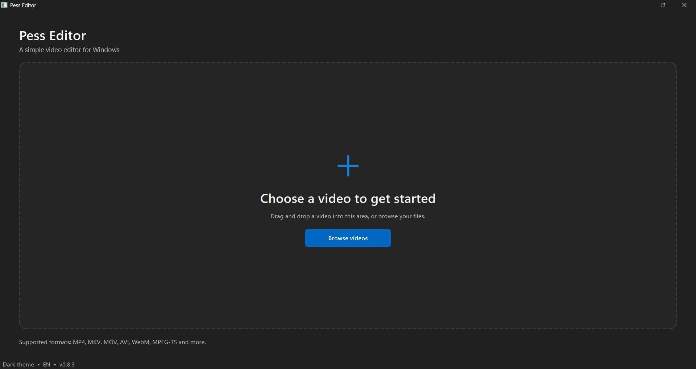
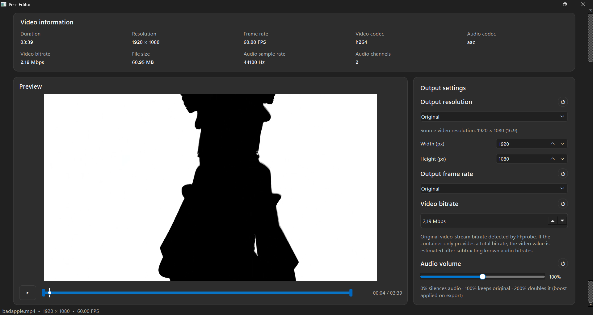

<div align="center">

# Pess Editor

**A small, lightweight video editing tool for Windows.**

[Download](https://github.com/Vik4mGD/PessEditor/releases) | [Source Code](https://github.com/Vik4mGD/PessEditor)

</div>

---

## About

Pess Editor is a lightweight desktop application for basic video editing and exporting.

Built with Python, PySide6 and FFmpeg, it aims to provide a simple and straightforward experience without the complexity of larger video editing software.

## Features

- Video preview.
- Basic video editing controls.
- Video export powered by FFmpeg.
- MP4 and MKV export.
- Automatic interface language detection.
- Multilingual interface: English, Spanish and Russian.
- Light and dark themes.
- Standalone Windows application.
- No separate Python installation required to run the packaged version.

## Screenshots

<div align="center">

### Main Interface



### Video Selected



</div>
## Download

Download the latest version from [GitHub Releases](https://github.com/Vik4mGD/PessEditor/releases).

Available formats:

- **Windows Installer:** Install Pess Editor using a standard setup wizard.
- **Portable ZIP:** Run Pess Editor without installing it.

## Building from Source

### Requirements

- Python
- Dependencies listed in `Build/requirements.txt`

### Instructions

1. Clone the repository:

   ```powershell
   git clone https://github.com/Vik4mGD/PessEditor.git


2. Open the project directory:
   cd PessEditor
3. Install the dependencies:
   python -m pip install -r Build/requirements.txt
4. Run the build script:
   .\Build\build.ps1
The main application source code is located in Source/main.py.
Project Structure
PessEditor/
├── Build/
│   ├── build.ps1
│   └── requirements.txt
├── LICENSES/
│   └── THIRD_PARTY_NOTICES.txt
├── Resources/
│   └── pess.ico
├── Source/
│   └── main.py
├── PessEditor.iss
└── README.md


Third-Party Licenses
Pess Editor uses third-party software and libraries.

See THIRD_PARTY_NOTICES.txt for additional information.
Version
0.8.3

